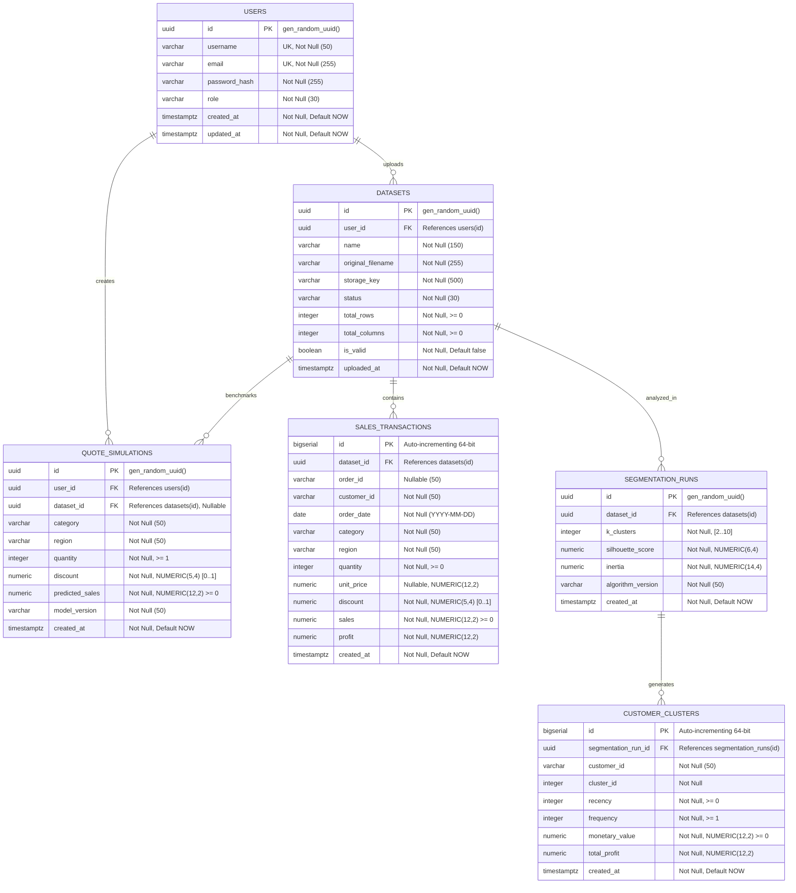

# BizInsightIQ: PostgreSQL Schema, Data Modeling & Migration Strategy (Phase 2)

**System Architecture:** Enterprise Polyglot AI/ML Analytics Workbench  
**Component:** Relational Persistence Tier (PostgreSQL 16+)  
**Authoritative Schema Owner:** Java 21 / Spring Boot 3 (Spring Data JPA + Flyway)  
**Target Audience:** Senior Database Architects, Enterprise Java Engineers & MCA Evaluators  

---

## 1. Executive Summary

Phase 2 establishes the **Relational Persistence Architecture** for BizInsightIQ. 

In Phase 0, BizInsightIQ operated as a single-workstation Streamlit script relying entirely on in-memory Pandas DataFrames and local CSV files. In Phase 1, we exposed the core data science models as a decoupled, stateless REST API via FastAPI. 

Phase 2 designs and establishes the **single source of truth for persistent business state**: a normalized, indexed PostgreSQL relational database managed by **Flyway migrations** under the future Spring Boot 3 application (`src/main/resources/db/migration/`).

### Core Design Rules Enforced:
1. **Single Authoritative Writer:** Spring Boot 3 (Java 21) is the sole owner of database transactions (`@Transactional`), schema migrations, and entity writes.
2. **Stateless AI/ML Worker:** FastAPI remains a stateless compute microservice. It does not maintain a second database write path, avoiding dual-write race conditions and distributed locking complexity.
3. **Strict Multi-Tenant Isolation:** All datasets and simulations are tied to a tenant/user identity (`user_id`).
4. **Idempotent Versioned Migrations:** Flyway versioned scripts (`V1__init_schema.sql`, `V2__seed_demo_data.sql`) guarantee reproducible schemas across developer workstations, Docker containers, and CI/CD pipelines.

---

## 2. Persistence Classification Matrix

Not every piece of data in an AI/ML system belongs in a relational database. We classify all system data into six distinct tiers:

| Data Category | Examples | Storage Target | Retention Policy | Rationale |
| :--- | :--- | :--- | :--- | :--- |
| **1. Identity & Auth** | Users, roles, credentials, audit timestamps | PostgreSQL (`users`) | Indefinite | Required for Spring Security authentication and RBAC. |
| **2. Dataset Metadata** | Filename, row count, validation status, storage URI | PostgreSQL (`datasets`) | Lifecycle of Dataset | Tracks uploaded assets and audit logs. |
| **3. Ingested Transactions** | Order date, customer ID, category, sales, profit, discount | PostgreSQL (`sales_transactions`) | Until Dataset Deleted | Normalized for fast SQL filtering, regional slicing, and reporting. |
| **4. ML Run History** | K-Means run, $k$ clusters, Silhouette score, Inertia | PostgreSQL (`segmentation_runs`) | Audit Window (1–3 yrs) | Academic and compliance audit of segmentation models. |
| **5. Customer Assignments** | Customer ID, cluster ID, RFM metrics | PostgreSQL (`customer_clusters`) | Until Run Superseded | Used by CRM and marketing retention workflows. |
| **6. Saved Quotes** | What-if scenario parameters, predicted sales | PostgreSQL (`quote_simulations`) | Long-term (Quote History) | Allows sales reps to review and export previously simulated quotes. |
| **7. Raw CSV Files** | Original uploaded `.csv` files | File/Blob Storage (`data/uploads/`) | Indefinite / Archival | Re-import idempotency and data provenance. Stored on disk, NOT in SQL. |
| **8. Ephemeral State** | Session filters, active currency mode, temporary NumPy arrays | In-Memory (Redis / Session State) | Ephemeral | Recomputed dynamically; zero database overhead. |

---

## 3. Relational Entity-Relationship Model



---

## 4. Detailed Data Dictionary & Schema Specifications

### 4.1 Table: `users`
Represents authenticated user identities, role-based authorization levels, and audit metadata.

| Column | Type | Nullable | Constraints & Defaults | Description |
| :--- | :--- | :--- | :--- | :--- |
| `id` | `UUID` | **No** | `PRIMARY KEY DEFAULT gen_random_uuid()` | Unique immutable identity. |
| `username` | `VARCHAR(50)` | **No** | `UNIQUE` | User login handle. |
| `email` | `VARCHAR(255)` | **No** | `UNIQUE` | Email address for communications. |
| `password_hash` | `VARCHAR(255)` | **No** | | BCrypt hashed password (cost factor $\ge 10$). Plaintext never stored. |
| `role` | `VARCHAR(30)` | **No** | `DEFAULT 'ROLE_ANALYST'`<br>`CHECK (role IN ('ROLE_ADMIN', 'ROLE_ANALYST', 'ROLE_SALES'))` | Spring Security authority identifier. |
| `created_at` | `TIMESTAMPTZ` | **No** | `DEFAULT CURRENT_TIMESTAMP` | Account creation timestamp. |
| `updated_at` | `TIMESTAMPTZ` | **No** | `DEFAULT CURRENT_TIMESTAMP` | Last profile update timestamp. |

---

### 4.2 Table: `datasets`
Represents uploaded business transaction datasets, parsing metadata, and ownership.

| Column | Type | Nullable | Constraints & Defaults | Description |
| :--- | :--- | :--- | :--- | :--- |
| `id` | `UUID` | **No** | `PRIMARY KEY DEFAULT gen_random_uuid()` | Unique dataset identifier. |
| `user_id` | `UUID` | **No** | `REFERENCES users(id) ON DELETE CASCADE` | Owner user ID for tenant isolation. |
| `name` | `VARCHAR(150)` | **No** | | Human-readable label given to dataset. |
| `original_filename`| `VARCHAR(255)` | **No** | | Source file name uploaded by user. |
| `storage_key` | `VARCHAR(500)` | **No** | | Internal storage path (e.g. `data/uploads/{uuid}.csv`). |
| `status` | `VARCHAR(30)` | **No** | `DEFAULT 'PENDING'`<br>`CHECK (status IN ('PENDING', 'VALIDATED', 'FAILED', 'ARCHIVED'))` | Dataset lifecycle state. |
| `total_rows` | `INTEGER` | **No** | `DEFAULT 0, CHECK (total_rows >= 0)` | Verified row count. |
| `total_columns` | `INTEGER` | **No** | `DEFAULT 0, CHECK (total_columns >= 0)` | Verified column count. |
| `is_valid` | `BOOLEAN` | **No** | `DEFAULT FALSE` | True if dataset passed validation. |
| `uploaded_at` | `TIMESTAMPTZ` | **No** | `DEFAULT CURRENT_TIMESTAMP` | Ingestion timestamp. |

---

### 4.3 Table: `sales_transactions`
Contains individual normalized transaction rows extracted from validated datasets.

| Column | Type | Nullable | Constraints & Defaults | Description |
| :--- | :--- | :--- | :--- | :--- |
| `id` | `BIGSERIAL` | **No** | `PRIMARY KEY` | Auto-incrementing 64-bit integer ID. |
| `dataset_id` | `UUID` | **No** | `REFERENCES datasets(id) ON DELETE CASCADE` | Parent dataset reference. |
| `order_id` | `VARCHAR(50)` | Yes | | External order ID (nullable if absent). |
| `customer_id` | `VARCHAR(50)` | **No** | | Customer account identifier. |
| `order_date` | `DATE` | **No** | | Transaction date (`YYYY-MM-DD`). |
| `category` | `VARCHAR(50)` | **No** | | Product line (`Technology`, `Furniture`, etc.). |
| `region` | `VARCHAR(50)` | **No** | | Geographic region (`East`, `West`, `South`, `North`). |
| `quantity` | `INTEGER` | **No** | `CHECK (quantity >= 0)` | Units purchased. |
| `unit_price` | `NUMERIC(12, 2)`| Yes | | Unit list price. |
| `discount` | `NUMERIC(5, 4)` | **No** | `CHECK (discount >= 0.0000 AND discount <= 1.0000)` | Concession rate ($0.0000$ to $1.0000$). |
| `sales` | `NUMERIC(12, 2)`| **No** | `CHECK (sales >= 0.00)` | Gross transaction revenue. |
| `profit` | `NUMERIC(12, 2)`| **No** | | Net profit (can be negative for losses). |
| `created_at` | `TIMESTAMPTZ` | **No** | `DEFAULT CURRENT_TIMESTAMP` | Insertion timestamp. |

---

### 4.4 Table: `segmentation_runs`
Records historical executions of unsupervised K-Means customer segmentation.

| Column | Type | Nullable | Constraints & Defaults | Description |
| :--- | :--- | :--- | :--- | :--- |
| `id` | `UUID` | **No** | `PRIMARY KEY DEFAULT gen_random_uuid()` | Execution run identifier. |
| `dataset_id` | `UUID` | **No** | `REFERENCES datasets(id) ON DELETE CASCADE` | Source dataset analyzed. |
| `k_clusters` | `INTEGER` | **No** | `CHECK (k_clusters >= 2 AND k_clusters <= 10)`| Number of clusters formed ($k$). |
| `silhouette_score` | `NUMERIC(6, 4)` | **No** | | Clustering separation quality score ($-1$ to $+1$). |
| `inertia` | `NUMERIC(14, 4)`| **No** | | Sum of squared distances to centroids. |
| `algorithm_version`| `VARCHAR(50)` | **No** | `DEFAULT 'KMeans-v1.0'` | Model version identifier. |
| `created_at` | `TIMESTAMPTZ` | **No** | `DEFAULT CURRENT_TIMESTAMP` | Execution timestamp. |

---

### 4.5 Table: `customer_clusters`
Contains individual customer cluster assignments and behavioral persona metrics for a specific segmentation run.

| Column | Type | Nullable | Constraints & Defaults | Description |
| :--- | :--- | :--- | :--- | :--- |
| `id` | `BIGSERIAL` | **No** | `PRIMARY KEY` | Auto-incrementing 64-bit integer ID. |
| `segmentation_run_id`| `UUID` | **No** | `REFERENCES segmentation_runs(id) ON DELETE CASCADE` | Parent segmentation run reference. |
| `customer_id` | `VARCHAR(50)` | **No** | | Customer identifier. |
| `cluster_id` | `INTEGER` | **No** | | Assigned cluster index ($0, 1, ..., k-1$). |
| `recency` | `INTEGER` | **No** | `CHECK (recency >= 0)` | Days since last purchase. |
| `frequency` | `INTEGER` | **No** | `CHECK (frequency >= 1)` | Total purchase count proxy. |
| `monetary_value` | `NUMERIC(12, 2)`| **No** | `CHECK (monetary_value >= 0.00)` | Cumulative customer spend. |
| `total_profit` | `NUMERIC(12, 2)`| **No** | | Cumulative customer net profit. |
| `created_at` | `TIMESTAMPTZ` | **No** | `DEFAULT CURRENT_TIMESTAMP` | Record insertion timestamp. |

*Unique Constraint:* `uq_run_customer UNIQUE (segmentation_run_id, customer_id)` guarantees that a customer can only belong to one cluster per run.

---

### 4.6 Table: `quote_simulations`
Persists "What-If" order simulations generated by sales representatives using the Random Forest regression engine.

| Column | Type | Nullable | Constraints & Defaults | Description |
| :--- | :--- | :--- | :--- | :--- |
| `id` | `UUID` | **No** | `PRIMARY KEY DEFAULT gen_random_uuid()` | Simulation record identifier. |
| `user_id` | `UUID` | **No** | `REFERENCES users(id) ON DELETE CASCADE` | Creator user account reference. |
| `dataset_id` | `UUID` | Yes | `REFERENCES datasets(id) ON DELETE SET NULL` | Reference dataset used for baseline. |
| `category` | `VARCHAR(50)` | **No** | | Quoted product category. |
| `region` | `VARCHAR(50)` | **No** | | Quoted destination region. |
| `quantity` | `INTEGER` | **No** | `CHECK (quantity >= 1)` | Quoted unit quantity. |
| `discount` | `NUMERIC(5, 4)` | **No** | `CHECK (discount >= 0.0000 AND discount <= 1.0000)` | Promotional discount rate applied. |
| `predicted_sales` | `NUMERIC(12, 2)`| **No** | `CHECK (predicted_sales >= 0.00)` | Model-forecasted gross sales. |
| `model_version` | `VARCHAR(50)` | **No** | `DEFAULT 'RandomForestRegressor-v1.0'` | Model version used for inference. |
| `created_at` | `TIMESTAMPTZ` | **No** | `DEFAULT CURRENT_TIMESTAMP` | Quote creation timestamp. |

---

## 5. Performance Indexing Strategy

Indexes have been deliberately placed to support the specific query patterns of the Spring Boot application and Next.js dashboards:

```sql
-- Fast lookup of user-owned datasets
CREATE INDEX idx_datasets_user_id ON datasets(user_id);

-- High-performance transactional queries (filtering by dataset, date, and category)
CREATE INDEX idx_sales_transactions_dataset_id ON sales_transactions(dataset_id);
CREATE INDEX idx_sales_transactions_dataset_date ON sales_transactions(dataset_id, order_date);
CREATE INDEX idx_sales_transactions_dataset_category ON sales_transactions(dataset_id, category);
CREATE INDEX idx_sales_transactions_dataset_region ON sales_transactions(dataset_id, region);
CREATE INDEX idx_sales_transactions_customer ON sales_transactions(dataset_id, customer_id);

-- Segmentation lookups and customer cluster personas
CREATE INDEX idx_segmentation_runs_dataset_id ON segmentation_runs(dataset_id);
CREATE INDEX idx_customer_clusters_run_id ON customer_clusters(segmentation_run_id);
CREATE INDEX idx_customer_clusters_customer ON customer_clusters(segmentation_run_id, customer_id);

-- User-specific quote simulation history
CREATE INDEX idx_quote_simulations_user_id ON quote_simulations(user_id);
```

---

## 6. Development Environment Setup

BizInsightIQ supports two parallel setup methods for local development:

### Option A: Native Local PostgreSQL 17 (Detected on Workstation)
* **Pre-installed Service:** `postgresql-x64-17` is already installed and running on `localhost:5432`.
* **Database Command Line:** `C:\Program Files\PostgreSQL\17\bin\psql.exe`.
* **Connecting via `psql`:**
  ```powershell
  & "C:\Program Files\PostgreSQL\17\bin\psql.exe" -U postgres -h localhost -p 5432 -d bizinsightiq_db
  ```

### Option B: Docker Compose (Portability & Production Replica)
* **Compose File:** [`docker-compose.yml`](file:///D:/PROJECTS_Workspace_2026/MCA_AI_ML_Project_and_Report/BizInsightIQ/docker-compose.yml)
* **Image:** `postgres:16-alpine`
* **Local Loopback Security:** Binds to `127.0.0.1:5432:5432` only.
* **Persistent Named Volume:** `bizinsightiq_pgdata`.
* **Healthcheck:** Automatic liveness testing via `pg_isready`.
* **Commands:**
  ```powershell
  # Copy placeholder config to active environment
  Copy-Item .env.example .env
  
  # Start PostgreSQL container in background
  docker compose up -d
  
  # View health and logs
  docker compose ps
  docker compose logs -f postgres
  
  # Stop container
  docker compose down
  ```

---

## 7. Migration Files & Verification

Flyway migrations are placed in the standard Spring Boot location:  
`src/main/resources/db/migration/` (with a convenience copy in `db/migration/`).

* **`V1__init_schema.sql`**: Full DDL defining 6 tables, primary keys, foreign keys with cascading rules, numeric check constraints, and performance indexes.
* **`V2__seed_demo_data.sql`**: Seeds demo identities (`admin`, `ramkrishna` with BCrypt hashes for `Password@123`), benchmark dataset reference, and baseline quote simulation.

### Automated Verification Results:
A dedicated automated test suite was added in [`tests/test_database_schema.py`](file:///D:/PROJECTS_Workspace_2026/MCA_AI_ML_Project_and_Report/BizInsightIQ/tests/test_database_schema.py):
* Table DDL definitions: **PASSED**
* Foreign key cascades: **PASSED**
* Numeric check constraints: **PASSED**
* Index completeness: **PASSED**
* BCrypt hash security (zero plaintext): **PASSED**
* Gitignore exclusion of secrets: **PASSED**

---

## 8. Complete Test Suite Status (119 Tests)

```text
============================= test session starts =============================
platform win32 -- Python 3.12.4, pytest-9.1.1
rootdir: D:\PROJECTS_Workspace_2026\MCA_AI_ML_Project_and_Report\BizInsightIQ
configfile: pytest.ini

tests/test_api.py ....................                                   [ 16%]
tests/test_database_schema.py ........                                   [ 23%]
tests/test_eda.py ................                                       [ 36%]
tests/test_insights.py .....................                             [ 54%]
tests/test_ml_prediction.py ..................                         [ 69%]
tests/test_ml_segmentation.py ...............                           [ 82%]
tests/test_validation.py ...............                                 [100%]

======================= 119 passed, 1 warning in 31.97s =======================
```

* **Baseline Tests Preserved:** 91 / 91 passed (100%)
* **FastAPI Tests Preserved:** 20 / 20 passed (100%)
* **Database & Migration Tests:** 8 / 8 passed (100%)
* **Total Passing Tests:** **119 / 119 (100%)**
* **Streamlit UI Application:** Fully functional and independent on port 8501/8502.

---

## 9. Final Decision for Phase 3

| Architectural Readiness Criterion | Evaluation | Status |
| :--- | :--- | :--- |
| **PostgreSQL Schema Design** | Normalized, indexed, strictly constrained. | **COMPLETED** |
| **Migration Strategy** | Flyway V1 & V2 scripts in standard Spring Boot location. | **COMPLETED** |
| **Development Environments** | Dual-support: Docker Compose + Native Windows Postgres 17. | **COMPLETED** |
| **Data Ownership Rules** | Spring Boot is single writer; FastAPI is stateless worker. | **VERIFIED** |
| **Secrets Protection** | `.env` ignored; `.env.example` placeholder template active. | **VERIFIED** |
| **Test Suite Regression** | 119 tests passing with zero failures. | **VERIFIED** |

### **DECISION: GREEN LIGHT (GO)**

Phase 2 is fully complete. We are ready to begin **Phase 3: Java 21 & Spring Boot 3 Enterprise Backend Implementation** (Entity creation with Spring Data JPA, Spring Security with JWT, Flyway execution, and `RestClient` integration with FastAPI).
