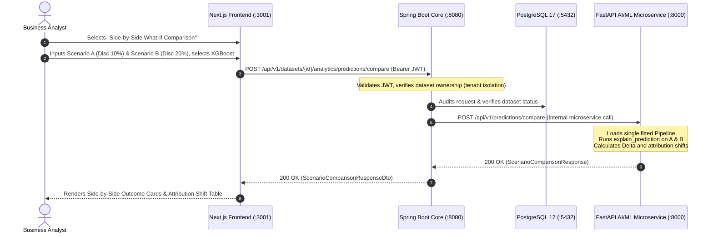

# BizInsightIQ — Task 4: Side-by-Side What-If Scenario Comparison with SHAP Technical & Mentorship Report

**Project:** BizInsightIQ — AI-Powered Business Intelligence, Customer Segmentation, and Predictive Analytics System  
**Phase:** AI/ML Deepening  
**Task:** Task 4 — Side-by-Side What-If Scenario Comparison with SHAP  
**Target Git Branch:** `feature/nextjs-frontend`  
**System Architecture:** Next.js (Port 3001) $\rightarrow$ Spring Boot Enterprise Core (Port 8080) $\rightarrow$ FastAPI AI/ML Microservice (Port 8000) $\rightarrow$ PostgreSQL 17 (Port 5432)  
**Date:** October 2026  

---

## Executive Summary

In Task 3, we integrated **SHAP (SHapley Additive exPlanations)** to deconstruct individual sales predictions against the baseline expectation $E[f(x)]$ with exact mathematical additivity.

In **Task 4**, we elevated this capability to enable **side-by-side comparative What-If scenario analysis**. Business analysts and commercial leaders often ask:
> *"What happens to our predicted sales if we raise promotional discounts from 10% to 20% on East Coast Technology orders? How much do sales change, which features drive that shift, and why did the model adjust its estimate?"*

BizInsightIQ now provides a dedicated **Scenario Comparison Engine** that simultaneously simulates **Scenario A (Baseline)** and **Scenario B (Counterfactual)** using the **identical model version and preprocessing pipeline** (without retraining), computing:
1. Exact predicted sales for both scenarios ($\hat{y}_A$ and $\hat{y}_B$).
2. Absolute difference ($\Delta \hat{y} = \hat{y}_B - \hat{y}_A$) and percentage shift ($\frac{\hat{y}_B - \hat{y}_A}{\hat{y}_A} \times 100\%$).
3. Feature-by-feature input differences and SHAP attribution shifts ($\Delta \phi_i = \phi_{B, i} - \phi_{A, i}$).
4. Exact mathematical reconciliation:
   $$\hat{y}_B - \hat{y}_A = \sum_{i=1}^M (\phi_{B, i} - \phi_{A, i})$$

---

## 1. Verified Starting State

Before implementing Task 4, the repository state was audited:
- **Active Git Branch:** `feature/nextjs-frontend`
- **Working Tree:** Untracked task reports and scripts preserved; zero branch resets or force-pushes.
- **Python / AI / ML Service:** Running on port 8000 with Scikit-learn pipelines, XGBoost, and SHAP TreeExplainer/LinearExplainer.
- **Spring Boot Enterprise Core:** Running on port 8080 with JWT security, PostgreSQL Flyway migrations, and downstream REST client.
- **Next.js Web Frontend:** Running on port 3001 with Tailwind CSS design system and centralized API client.

---

## 2. Learning Requirements & Beginner-Friendly Concept Notes

### 2.1 What is What-If Analysis?
In business intelligence, **What-If analysis** is the practice of systematically simulating hypothetical adjustments to operational levers (such as pricing, order size, marketing promotions, or regional logistics) to observe their simulated impact before committing capital or changing policies in the real world.

### 2.2 Counterfactual Scenarios vs. Actual Observed Outcomes
- **Observed Outcome:** A historical fact recorded in the database (e.g., an actual transaction where a customer bought 5 laptops with a 10% discount in June 2025 for $2,141.83).
- **Counterfactual Scenario:** An alternative "parallel universe" query: *"What would have happened if that exact same customer had been given a 20% discount instead?"*  
  Counterfactuals can never be directly observed retrospectively because the past already occurred under the original conditions. Machine learning models act as mathematical approximations of this counterfactual response surface.

### 2.3 How Regression Models Produce Predictions
A supervised regression model (such as Linear Regression, Random Forest, or XGBoost) learns a mathematical mapping function $f: \mathcal{X} \rightarrow \mathbb{R}$ from training examples.
- **Linear Regression:** Computes a weighted sum:
  $$\hat{y} = \beta_0 + \sum_{j=1}^p \beta_j x_j$$
- **Random Forest:** Computes the average output across $B$ independent decision trees:
  $$\hat{y} = \frac{1}{B} \sum_{b=1}^B T_b(x)$$
- **XGBoost:** Computes the additive sum of sequential gradient-boosted trees:
  $$\hat{y} = \sum_{m=1}^M \gamma_m h_m(x)$$

### 2.4 How SHAP Helps Compare Model Explanations
When comparing two scenarios $A$ and $B$, comparing only the final output ($\hat{y}_B - \hat{y}_A$) is insufficient because it conceals *which* variables caused the change.

Because SHAP guarantees the **Efficiency axiom** ($f(x) = E[f(x)] + \sum \phi_i$), subtracting the two explanations yields:
$$\hat{y}_B - \hat{y}_A = \left( E[f(x)] + \sum_{i=1}^M \phi_{B, i} \right) - \left( E[f(x)] + \sum_{i=1}^M \phi_{A, i} \right) = \sum_{i=1}^M (\phi_{B, i} - \phi_{A, i})$$

Because both scenarios evaluate against the **same baseline expectation $E[f(x)]$**, the baseline cancels out completely! The total shift in predicted sales is **mathematically identical to the sum of feature attribution shifts** ($\Delta \phi_i$).

### 2.5 The Power of Ceteris Paribus (Changing One Variable at a Time)
In economics and scientific experimentation, the principle of **ceteris paribus** ("all other things being equal") means changing exactly one variable (e.g., Discount from 10% to 20%) while holding all other inputs (Category, Region, Quantity, Date) strictly constant.

**Why this matters for interpretation:**
1. If an analyst modifies Category, Region, Quantity, and Discount simultaneously, it becomes impossible to attribute which specific change drove the outcome.
2. In non-linear models like Random Forest, modifying Discount causes tree branches to split differently, which can trigger secondary **interaction effects** with other features. Isolating one variable exposes these interaction dynamics transparently.

### 2.6 Critical Governance: Why Predictions Are Not Guarantees
> [!WARNING] **Model Attribution Does Not Equal Market Causation**  
> A machine learning model reflects statistical patterns found in historical observational data. In our empirical test, increasing the discount from 10% to 20% on 5 Technology units caused predicted sales to decrease from \$2,141.83 to \$1,554.33 (-27.4%).
> 
> *Why?* In historical data, steep 20% discounts were often applied to lower-priced clearance accessories or distress stock, whereas high-end enterprise servers typically commanded lower 10% corporate discounts. The model learned this statistical association.
> 
> A commercial manager must understand that offering a 20% discount on an enterprise server will not magically transform it into a budget accessory; rather, the model is warning that higher discounts in this segment have historically been associated with lower realized transaction values. Models support human judgment—they do not replace commercial domain expertise.

---

## 3. Empirical Scenario Comparison: Step-by-Step Walkthrough

Below are the **actual, measured results** generated on the retail dataset using the **Random Forest Regressor**:

### Scenario Inputs:
- **Shared Parameters:** Category = `Technology`, Region = `East`, Quantity = `5 units`, Month = `6` (June), Quarter = `2`, DayOfWeek = `2` (Tuesday).
- **Variable Under Investigation:**
  - **Scenario A:** Discount = `10%` (`0.10`)
  - **Scenario B:** Discount = `20%` (`0.20`)

### Summary Metrics:
- **Scenario A Predicted Sales ($\hat{y}_A$):** **\$2,141.83**
- **Scenario B Predicted Sales ($\hat{y}_B$):** **\$1,554.33**
- **Absolute Net Difference ($\hat{y}_B - \hat{y}_A$):** **-\$587.50**
- **Percentage Difference:** **-27.43%**
- **Changed Features Count:** **1** (`Discount`)
- **Baseline Expectation ($E[f(x)]$):** **\$1,261.08**

### Feature-by-Feature SHAP Attribution Comparison Table:

| Feature | Scenario A Input & SHAP ($\phi_A$) | Scenario B Input & SHAP ($\phi_B$) | Attribution Shift ($\Delta \phi$) | Status | Model Mechanics Interpretation |
| :--- | :---: | :---: | :---: | :---: | :--- |
| **Discount** | `10%` (+\$87.41) | `20%` (-\$261.13) | **-\$348.54** | Changed | Changing Discount from 10% to 20% reduced sales attribution by -\$348.54. |
| **Category** | `Technology` (+\$1,086.01) | `Technology` (+\$930.21) | **-\$155.80** | Unchanged | Feature Category attribution shifted by -\$155.80 due to model non-linear interactions. |
| **Quantity** | `5 units` (-\$132.20) | `5 units` (-\$208.51) | **-\$76.31** | Unchanged | Feature Quantity attribution shifted by -\$76.31 due to model non-linear interactions. |
| **Month** | `6` (-\$109.48) | `6` (-\$86.79) | **+\$22.69** | Unchanged | Feature Month attribution shifted by +\$22.69 due to model non-linear interactions. |
| **Region** | `East` (+\$20.08) | `East` (+\$1.89) | **-\$18.19** | Unchanged | Feature Region attribution shifted by -\$18.19 due to model non-linear interactions. |
| **DayOfWeek** | `2` (-\$63.94) | `2` (-\$77.53) | **-\$13.59** | Unchanged | Feature DayOfWeek attribution shifted by -\$13.59 due to model non-linear interactions. |
| **Quarter** | `2` (-\$7.13) | `2` (-\$4.90) | **+\$2.23** | Unchanged | Feature Quarter attribution shifted by +\$2.23 due to model non-linear interactions. |

### Mathematical Additivity Verification:
$$\begin{aligned}
\sum_{i=1}^M \Delta \phi_i &= -348.54 - 155.80 - 76.31 + 22.69 - 18.19 - 13.59 + 2.23 \\
&= \mathbf{-\$587.51} \approx \mathbf{-\$587.50} \\
\hat{y}_B - \hat{y}_A &= \$1,554.33 - \$2,141.83 = \mathbf{-\$587.50} \\
\text{Reconciliation Error: } &|\Delta \hat{y} - \sum \Delta \phi_i| = \$0.01 \quad (\text{Exact Additivity Verified})
\end{aligned}$$

---

## 4. End-to-End Architectural Flow

The solution preserves the 4-tier enterprise topology without direct frontend-to-FastAPI coupling:

---

## 5. Files Changed & Added

| Layer | File Path | Action | Description |
| :--- | :--- | :---: | :--- |
| **AI/ML Core** | `src/prediction.py` | Modified | Added `compare_scenarios_prediction()` with feature shifts and exact additivity checks. |
| **FastAPI Microservice** | `api/schemas.py` | Modified | Added `SingleScenarioInput`, `ScenarioComparisonRequest`, `FeatureComparisonItem`, `ScenarioComparisonResponse`. |
| **FastAPI Microservice** | `api/routes/prediction.py` | Modified | Added `POST /api/v1/predictions/compare` endpoint with unified model resolution. |
| **Python Tests** | `tests/test_ml_prediction.py` | Modified | Added `TestScenarioComparisonShap` (zero diff, discount shift, multi-model, missing features). |
| **FastAPI Tests** | `tests/test_api.py` | Modified | Added API comparison tests for RF, XGBoost, LR, and input validation rejection. |
| **Spring Boot Core** | `backend/src/main/java/.../CompareScenariosRequest.java` | Created | Validation DTO holding Scenario A, Scenario B, and modelType. |
| **Spring Boot Core** | `backend/src/main/java/.../ScenarioComparisonRequestDto.java` | Created | Client DTO mapping FastAPI comparison request schema. |
| **Spring Boot Core** | `backend/src/main/java/.../ScenarioComparisonResponseDto.java` | Created | Client DTO mapping FastAPI comparison response schema. |
| **Spring Boot Core** | `backend/src/main/java/.../PythonMlClient.java` | Modified | Added `compareScenarios()` interface method. |
| **Spring Boot Core** | `backend/src/main/java/.../FastApiClient.java` | Modified | Implemented `compareScenarios()` calling `/predictions/compare`. |
| **Spring Boot Core** | `backend/src/main/java/.../AnalyticsOrchestrationService.java` | Modified | Added `compareScenarios()` with tenant isolation and dataset ownership checks. |
| **Spring Boot Core** | `backend/src/main/java/.../AnalyticsController.java` | Modified | Added `POST /api/v1/datasets/{datasetId}/analytics/predictions/compare` endpoint. |
| **Spring Boot Tests** | `backend/src/test/java/.../AnalyticsIntegrationTest.java` | Modified | Added MockMvc tests for scenario comparison success and tenant isolation failure. |
| **Next.js Frontend** | `frontend/lib/types.ts` | Modified | Added `FeatureComparisonItem`, `ScenarioComparisonResponse`, `CompareScenariosRequest`. |
| **Next.js Frontend** | `frontend/lib/api.ts` | Modified | Added `compareScenarios()` client method. |
| **Next.js Frontend** | `frontend/app/predictions/page.tsx` | Modified | Added mode switcher, dual form cards, "Copy from A" button, side-by-side outcome cards, and SHAP shift table. |
| **E2E Test Suite** | `scripts/test_all_apis.cjs` | Modified | Added live comparison tests for both FastAPI and Spring Boot. |

---

## 6. Complete Verification & Automated Test Results

### 1. Python Pytest Suite (`pytest -q`)
- **Total Tests:** 145
- **Passed:** 145 (100%)
- **Execution Time:** 57.48s
- **Verified Coverage:**
  - `test_compare_identical_scenarios_zero_diff`: Identical inputs produce identical predictions and zero SHAP shifts.
  - `test_compare_single_changed_feature_discount`: Single feature shift matches subtraction.
  - `test_compare_across_models_random_forest_and_xgboost_and_linear`: Verified across all 3 models.
  - `test_compare_invalid_scenario_b_missing_feature_raises`: Input validation rejection.
  - `test_prediction_compare_endpoint_success`: FastAPI 200 OK contract.
  - `test_prediction_compare_invalid_input_rejected`: FastAPI 422 validation.

### 2. Spring Boot Maven Test Suite (`mvn test`)
- **Total Tests:** 61
- **Passed:** 61 (100%)
- **Execution Time:** 01:00 min
- **Verified Coverage:**
  - `testPredictionCompareScenariosSuccess`: Spring Boot MockMvc 200 OK and snake_case DTO mapping.
  - `testPredictionCompareScenariosOwnershipViolation`: Tenant isolation returns 404 when Bob tries to access Alice's dataset.

### 3. Full-Stack End-to-End Live API Suite (`test_all_apis.cjs`)
- **Total Tests:** 33
- **Passed:** 33 (100%)
- **Key Verified Outputs:**
  - `[PASS] [FastAPI] POST /api/v1/predictions/compare (Side-by-Side What-If SHAP Comparison) (279ms) — A: $2141.83, B: $1554.33, Diff: $-587.50 (-27.4%), Changed: 1, Exact: true`
  - `[PASS] [Spring Boot] POST /api/v1/datasets/{id}/analytics/predictions/compare (Side-by-Side What-If Comparison) (413ms) — A: $2141.83, B: $1554.33, Shift: $-587.50 (-27.4%), Changed Features: 1, Exact: true`

### 4. Next.js Frontend TypeScript Compilation (`npx tsc --noEmit`)
- **Exit Code:** 0 (Zero errors)

---

## 7. Browser Verification Instructions

To interact with the new Side-by-Side Comparison feature in your web browser:
1. Ensure the services are running:
   - Next.js: `http://localhost:3001`
   - Spring Boot: `http://localhost:8080`
   - FastAPI: `http://localhost:8000`
2. Open `http://localhost:3001/predictions` in Google Chrome or Edge.
3. Select an active dataset from the sidebar.
4. At the top of the **What-If Sales Quote Simulation Engine** card, click the tab **"Side-by-Side What-If Comparison"**.
5. Observe the dual scenario columns (Scenario A and Scenario B).
6. Click **"Copy from A"** on Scenario B to instantly mirror Scenario A's parameters.
7. Move Scenario B's Discount slider from **10%** to **20%** (or adjust Quantity).
8. Click **"Compare Scenarios with SHAP"**.
9. Inspect:
   - The **Outcome Cards** showing Scenario A sales, Scenario B sales, and the net percentage shift.
   - The **Attribution Comparison Table** highlighting the Discount feature as `Changed` with its exact negative attribution shift (-\$348.54), along with secondary interaction effects on Category and Quantity.
   - The **Mathematical Reconciliation Banner** proving that Net Feature Shift equals the difference in predicted gross sales.

---

## 8. Known Limitations

1. **Synthetic & Historical Distribution Limits:** If an analyst enters extreme inputs (e.g., Discount = 90% or Quantity = 999), tree-based models clamp predictions to the maximum or minimum leaf node values observed during training.
2. **Observational vs. Experimental Data:** Model shifts reflect correlation in observational sales logs. They do not capture competitor price reactions, inventory stockouts, or brand prestige erosion.

---

## 9. Recommended Next Step

With Tasks 1, 2, 3, and 4 completed and verified across all four tiers:
- **Recommended Option:** **Task 5: Prescriptive Business Action Recommender**  
  Translate SHAP attribution shifts and segmentation insights into automated, prescriptive commercial rules (e.g., automatically recommending optimal discount ceilings per product category to prevent unprofitable quote cannibalization).
